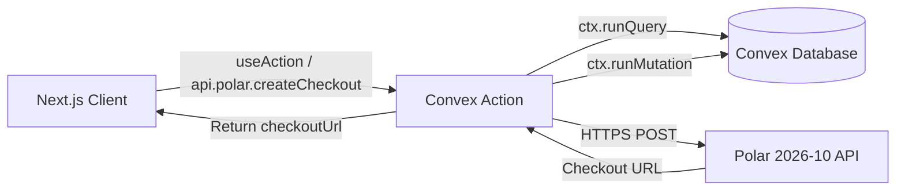

# Convex Actions & External APIs for Qatify

> **Official Reference**: [Convex Actions](https://docs.convex.dev/functions/actions)  
> **Target File**: `convex/polar.ts`

---

## 1. What are Convex Actions?

In Convex:
- **Queries and Mutations** must be deterministic and pure; they cannot make arbitrary network requests (like calling Stripe, Polar, OpenAI, or Twilio).
- **Actions (`action`)** are designed specifically to interact with external third-party services and APIs.
- Actions can:
  - Call third-party REST APIs via `fetch` or npm SDKs like `@polar-sh/sdk`.
  - Read server environment variables (`process.env.POLAR_ACCESS_TOKEN`).
  - Read database state by calling `ctx.runQuery()`.
  - Write database changes by calling `ctx.runMutation()`.



---

## 2. Polar Checkout Action (`convex/polar.ts`)

```typescript
"use node";

import { v } from "convex/values";
import { action } from "./_generated/server";
import { internal } from "./_generated/api";

export const createCheckoutSession = action({
  args: {
    orderId: v.id("orders"),
  },
  handler: async (ctx, args) => {
    // 1. Fetch order details from Convex DB via internal query
    const order = await ctx.runQuery(internal.orders.getOrderByIdInternal, {
      orderId: args.orderId,
    });

    if (!order) {
      throw new Error("Order not found");
    }

    const polarToken = process.env.POLAR_ACCESS_TOKEN;
    if (!polarToken) {
      throw new Error("POLAR_ACCESS_TOKEN environment variable is not configured");
    }

    const siteUrl = process.env.NEXT_PUBLIC_SITE_URL || "http://localhost:3000";

    // 2. Call Polar 2026-10 Checkouts API
    // Endpoint: POST https://api.polar.sh/v1/checkouts (or sandbox: https://sandbox-api.polar.sh/v1/checkouts)
    const isSandbox = process.env.POLAR_ENVIRONMENT === "sandbox";
    const polarApiUrl = isSandbox
      ? "https://sandbox-api.polar.sh/v1/checkouts"
      : "https://api.polar.sh/v1/checkouts";

    // Convert QAR amount to subunit (Polar uses minor currency units e.g., cents or dirhams)
    // 1 QAR = 100 Dirhams
    const amountInSubunits = Math.round(order.totalQar * 100);

    const payload = {
      // Custom ad-hoc pricing product or catalog product ID
      amount: amountInSubunits,
      currency: "qar",
      allow_discount_codes: true,
      require_billing_address: false,
      customer_email: order.customerEmail,
      customer_name: order.customerName,
      success_url: `${siteUrl}/checkout/success?orderNumber=${order.orderNumber}&session_id={CHECKOUT_ID}`,
      cancel_url: `${siteUrl}/cart`,
      metadata: {
        orderId: order._id,
        orderNumber: order.orderNumber,
        customerPhone: order.customerPhone,
        shippingZone: order.shippingAddress.zone,
        shippingCity: order.shippingAddress.city,
      },
    };

    const response = await fetch(polarApiUrl, {
      method: "POST",
      headers: {
        "Content-Type": "application/json",
        Authorization: `Bearer ${polarToken}`,
      },
      body: JSON.stringify(payload),
    });

    if (!response.ok) {
      const errorText = await response.text();
      throw new Error(`Polar Checkout API error (${response.status}): ${errorText}`);
    }

    const checkoutData = await response.json();

    // 3. Save Polar checkout session ID into the order record
    await ctx.runMutation(internal.orders.setPolarCheckoutId, {
      orderId: order._id,
      polarCheckoutId: checkoutData.id,
    });

    // 4. Return checkout redirect URL to the client
    return {
      checkoutId: checkoutData.id,
      checkoutUrl: checkoutData.url,
    };
  },
});
```

---

## 3. Frontend Invocation (Next.js)

In your Checkout page (`app/checkout/page.tsx`):

```tsx
"use client";

import { useMutation, useAction } from "convex/react";
import { api } from "@/convex/_generated/api";
import { useState } from "react";

export function CheckoutSubmitButton({ orderPayload }: { orderPayload: any }) {
  const [loading, setLoading] = useState(false);
  const createOrder = useMutation(api.orders.createOrder);
  const createCheckoutSession = useAction(api.polar.createCheckoutSession);

  const handleCheckout = async () => {
    try {
      setLoading(true);

      // 1. Create order in Convex
      const { orderId } = await createOrder(orderPayload);

      // 2. Create Polar Checkout Session
      const { checkoutUrl } = await createCheckoutSession({ orderId });

      // 3. Redirect customer to Polar's high-conversion checkout page
      window.location.href = checkoutUrl;
    } catch (err) {
      console.error("Checkout initiation failed:", err);
      alert("Failed to initiate checkout. Please try again.");
    } finally {
      setLoading(false);
    }
  };

  return (
    <button onClick={handleCheckout} disabled={loading} className="btn-pay-now">
      {loading ? "Redirecting to Secure Payment..." : "Proceed to Payment (QAR)"}
    </button>
  );
}
```

