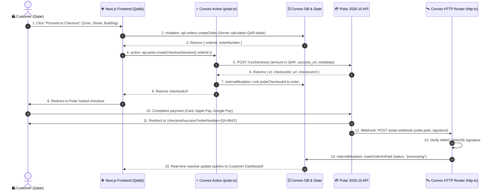

# End-to-End Qatify Backend Architecture Blueprint

> **Stack**: Next.js 15 (App Router) + Convex + Polar 2026-10 + SCSS  
> **Market Focus**: Qatar Dropshipping (6–10 Days Tracked Air Express)

---

## 1. System Architecture Diagram



---

## 2. Qatar Dropshipping Fulfillment Timeline (6–10 Days)

Once the `order.paid` event is received, Qatify activates the step-by-step shipment tracking engine:

| Step | Milestone | Location | Target Time |
| :---: | :--- | :--- | :--- |
| **1** | **Payment Verified & Batch Inspection** | Global Logistics Hub | Day 1 |
| **2** | **Direct Air Express Departed** | International Freight Wing | Day 2 – 4 |
| **3** | **Arrived in Qatar & Customs Clearance** | Hamad International Airport (DOH) | Day 5 – 7 |
| **4** | **Out for Delivery with Local Courier** | Doha Local Distribution Hub | Day 7 – 9 |
| **5** | **Delivered to Doorstep** | Customer Zone / Street (Qatar) | Day 6 – 10 |

All milestones are stored in the Convex `shipment_events` table and pushed reactively to the customer's `/dashboard` or `/tracking` page.

---

## 3. Environment Variables Reference

Create or update `.env.local`:

```env
# ==============================================================================
# QATIFY FRONTEND & CONVEX CONFIGURATION
# ==============================================================================
NEXT_PUBLIC_SITE_URL="http://localhost:3000"
NEXT_PUBLIC_CONVEX_URL="https://your-deployment-name.convex.cloud"
CONVEX_DEPLOYMENT="dev:your-deployment-name"

# ==============================================================================
# POLAR 2026-10 PAYMENT GATEWAY CONFIGURATION
# ==============================================================================
# Environment: 'sandbox' for testing, 'production' for live payments
POLAR_ENVIRONMENT="sandbox"

# Organization / Personal Access Token from https://sandbox.polar.sh/settings
POLAR_ACCESS_TOKEN="polar_oat_your_access_token_here"

# Webhook signing secret from Polar Dashboard -> Webhooks
POLAR_WEBHOOK_SECRET="whsec_your_webhook_signing_secret_here"
```

Also sync the secret keys to Convex cloud:

```bash
npx convex env set POLAR_ENVIRONMENT "sandbox"
npx convex env set POLAR_ACCESS_TOKEN "polar_oat_your_access_token_here"
npx convex env set POLAR_WEBHOOK_SECRET "whsec_your_webhook_signing_secret_here"
npx convex env set NEXT_PUBLIC_SITE_URL "http://localhost:3000"
```

---

## 4. Next Implementation Steps for Backend

1. **Run `npx convex dev`**: This will generate the `convex/_generated/` folder and link your Convex project.
2. **Install Polar SDK**: `npm install @polar-sh/sdk standardwebhooks`.
3. **Commit Database Schema**: Place the finalized schema in `convex/schema.ts`.
4. **Seed Products**: Migrate existing mock products from `data/products.ts` into the Convex `products` table using `seedProducts` mutation.
5. **Connect Checkout Page**: Wire `app/checkout/page.tsx` to call Convex `createOrder` and `createCheckoutSession`.
6. **Set up Webhook Endpoint**: Configure Polar webhook destination to point to your `.convex.site/polar-webhook`.

